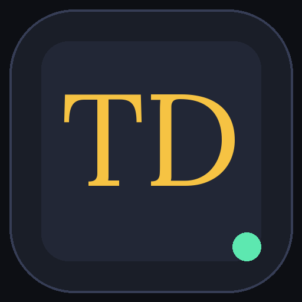

<div align="center">



# TeacherDesk Kashmir

### A practical digital workspace for teachers.

Plan classes. Track students. Record attendance. Manage assessments.  
Handle everyday school work — all in one place.

<p>
  <a href="https://teacherdeskkashmir.edgeone.dev/">
    
  </a>
</p>

<p>
  
  
  
  
</p>

**Built for teachers · Designed for everyday classrooms · Developed in Kashmir**

</div>

---

## 📌 Table of Contents

- [About](#-about)
- [Get Started](#-get-started)
- [Why TDK?](#-why-tdk)
- [Features](#-features)
- [Announcements](#-announcements)
- [Head of Institute](#-head-of-institute)
- [Data and Security](#-data-and-security)
- [UDISE School Lookup](#-udise-school-lookup)
- [Technology and Devices](#-technology-and-devices)
- [RSBVP](#-rsbvp)
- [Creator](#-creator)
- [Project Structure](#-project-structure)
- [License](#-license)

---

## 🏫 About

**TeacherDesk Kashmir (TDK)** is a teacher-focused web application designed to make everyday classroom work simpler, more organised, and easier to manage.

Teachers regularly handle attendance, student records, marks, assessments, homework, lesson planning, reports, classroom activities, and school communication. TDK brings these workflows together in one workspace instead of requiring teachers to depend on multiple disconnected tools.

> [!IMPORTANT]
> **Technology should reduce a teacher's workload, not add to it.**

TDK is built around practical classroom needs and is designed for the devices teachers already use.

---

## 🚀 Get Started

<div align="center">

### Ready to use TeacherDesk Kashmir?

<a href="https://teacherdeskkashmir.edgeone.dev/">
  
</a>

</div>

### First-time users

Follow these steps to create your account and access the application.

**1. Open the website**

Visit the official application:  
**[teacherdeskkashmir.edgeone.dev](https://teacherdeskkashmir.edgeone.dev/)**

**2. Sign up**

Choose the **Sign Up** option and complete the registration form with the information requested by the application. Provide institute details when requested.

**3. Create your login credentials**

Complete registration and set up your login key and password as prompted by the website.

**4. Log in**

Return to the login page, enter your login key and password, and submit the form.

**5. Open your workspace**

After successful login, use the features available to your account role and permissions.

> [!TIP]
> Keep your login credentials private. If you already have an account, use the login page instead of registering again.

---

## 💡 Why TDK?

Everyday school tasks can become repetitive and time-consuming when handled manually.

TDK aims to bring common workflows into one organised platform:

- Take attendance
- Maintain student records
- Record marks and results
- Prepare assessments
- Track homework
- Plan lessons
- Organise classroom activities
- Create reports
- Share school updates

**The goal: less paperwork, less switching between tools, and better organisation.**

---

## ✨ Features

<details open>
<summary><strong>🏫 Class Management</strong></summary>

- Create and manage classes
- Add and manage students
- Assign subjects and classroom information
- Store student roll numbers
- Switch between active classes
- Manage classroom rosters
- Compare classes
- Create seating charts
- Manage timetables

</details>

<details open>
<summary><strong>📝 Attendance</strong></summary>

- Mark daily attendance
- Track present, absent, and late statuses
- Keep time-stamped attendance records
- View attendance statistics
- Review student-level attendance history
- Access yearly attendance information

</details>

<details open>
<summary><strong>📊 Assessments and Grades</strong></summary>

- Grade Book
- Assessments
- Marks and percentages
- Quiz Maker
- Test Paper Generator
- Performance Analytics
- Marks-to-grade conversion
- Exit Tickets
- Yearly student results

</details>

<details>
<summary><strong>👨‍🎓 Student Management</strong></summary>

- Student profiles and records
- Attendance history
- Academic results
- Behaviour tracking
- Homework tracking
- Yearly performance information
- Class-based student management

</details>

<details>
<summary><strong>📅 Planning and Organisation</strong></summary>

- Lesson Plans
- Timetable
- Syllabus Tracker
- Class Calendar
- Quick Notes
- Daily Summary
- Resource Library
- Report Cards
- Certificates

</details>

<details>
<summary><strong>🎲 Classroom Tools</strong></summary>

- Random Picker
- Class Timer
- Seating Chart
- Class Polls
- Exit Tickets
- Quick classroom utilities

</details>

---

## 📢 Announcements

TDK includes an **Announcements** section for school-wide communication.

The intended workflow is:

**Head of Institute → Announcement → Teachers**

When the Head of Institute publishes an announcement, teachers belonging to that institute can view it in their Announcements section, subject to the application's configured permissions.

Leave-related updates can also appear there, keeping important school communication in one place.

---

## 🏢 Head of Institute

TDK supports two account roles:

- **Teacher**
- **Head of Institute (HOI)**

Depending on configured permissions, the Head of Institute can:

- View teachers in the institute
- Inspect teacher information
- View teacher classes
- Review student rosters
- Review attendance statistics
- Review academic results
- Manage classroom information
- Reassign classroom information
- Remove teachers
- Export teacher reports
- Publish school-wide announcements
- Communicate leave-related updates

This provides an institute-level view while keeping individual teacher workflows organised.

---

## 🔐 Data and Security

TDK uses **Supabase**, including PostgreSQL and authentication.

The application uses database-level **Row Level Security (RLS)** policies to control access to institute and teacher data.

```text
                    Institute
                       |
          +------------+------------+
          |                         |
       Teachers                Announcements
          |
     +----+----+
     |         |
  Classes   Teacher Data
     |
  Students
     |
  Attendance
     |
 Assessments
     |
   Results
```

Teacher accounts are associated with an institute so the application can distinguish between individual teacher data and institute-level information.

> [!NOTE]
> Actual data protection depends on the deployed application's database policies, authentication configuration, and permissions.

---

## 🏫 UDISE School Lookup

TDK supports school lookup using **UDISE codes** during registration.

Where school details are available through the configured lookup service, the application can retrieve information associated with a school's UDISE code. This can reduce manual data entry and help users select the correct institute.

---

## 💻 Technology and Devices

| Area | Technology or support |
|:--|:--|
| Application | Web application |
| Database and authentication | Supabase |
| Database | PostgreSQL |
| Access | Phone, laptop, desktop, and classroom PC |

The interface focuses on quick access to frequently used tools and practical everyday workflows.

---

## 🔬 RSBVP

TeacherDesk Kashmir is being presented through the **Rajya Stariya Bal Vaigyanik Pradarshani (RSBVP)**.

RSBVP provides a platform to present the project, while the project's core purpose remains practical: creating a useful digital workspace for teachers and real classrooms.

---

## 👨‍💻 Creator

<div align="center">

### Mohd Izhan Wani

**GMHSS Nanil**

Independently developed with a focus on real classroom needs and making routine teaching work more manageable.

</div>

---

## 📁 Project Structure

The main application is kept simple and primarily contained within a single HTML file.

```text
TeacherDesk-Kashmir/
├── TDK10.html
├── tdk-logo-512.png
└── README.md
```

---

## 📜 License

**Copyright © 2026 Mohd Izhan Wani. All rights reserved.**

TeacherDesk Kashmir, including its original source code, interface design, layout, branding, application logic, and implementation, is the original work of Mohd Izhan Wani.

Permission is not granted to copy, redistribute, modify, rebrand, sell, or publish substantial portions of the project without explicit permission from the author.

Data entered by users belongs to those users and is handled through the application's configured database infrastructure.

---

<div align="center">

## TeacherDesk Kashmir

**Built for teachers. Built from real classroom problems.**

[](https://teacherdeskkashmir.edgeone.dev/)

Made with ❤️ by **Mohd Izhan Wani · GMHSS Nanil**

</div>
